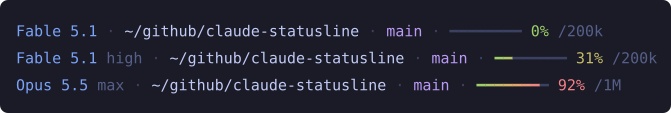

# claude-statusline

A status line for [Claude Code](https://code.claude.com): model and reasoning effort, working directory, git branch, and an eight-cell context bar that shades from green to red.



One dependency-free `statusline.mjs`, run by Node on every refresh. Tokyo Night colors.

## Install

Requires Node 22 or newer. Run once on each machine where you use Claude Code:

```sh
curl -fsSL https://github.com/DDDDD12138/claude-statusline/releases/latest/download/install.mjs | node -
```

The installer downloads the bundle into `~/.claude/statusline.mjs` and sets `statusLine` in `~/.claude/settings.json`, leaving every other setting as it was. Start a new Claude Code session to see it.

| Flag | Effect |
| --- | --- |
| `--version <tag>` | Install that release instead of the latest |
| `--dry-run` | Print what would change without writing anything |

Re-run the same command to update. To remove, delete `~/.claude/statusline.mjs` and the `statusLine` key.

## What it shows

| Segment | Source | Hidden when |
| --- | --- | --- |
| Model + effort | `model.display_name`, `effort.level` | effort is hidden when the model has no effort setting |
| Directory | `workspace.current_dir`, home collapsed to `~` | never |
| Branch | `git symbolic-ref`, short SHA when detached; cached 5s per session | not a git repository |
| Context | `context_window.used_percentage`, `context_window_size` | never; shows 0% before the first response |

## Develop

```sh
pnpm install
pnpm dev      # rebuild on change and render test/fixtures in the terminal
pnpm test
pnpm check    # lint + typecheck
```

`pnpm dev` only writes to `dist/`; nothing touches `~/.claude` unless you run the installer.

```
src/
├── main.ts            read stdin, render, print
├── types.ts           the JSON Claude Code sends, from the official docs
├── render.ts          join segments; a throwing segment is skipped
├── ansi.ts            24-bit color helpers
├── theme/             color tokens
├── segments/          one file per segment, registered in index.ts
└── installer/         the install script
```

To add a segment: create `src/segments/<name>.ts` exporting a `Segment` (a function from `{ input, theme }` to a string, or `null` to hide), add it to the list in `src/segments/index.ts`, and extend the expected lines in `test/fixtures.test.ts`. After changing what the line looks like, run `pnpm svg` to refresh the README image.

Set `STATUSLINE_DEBUG=1` to send errors to stderr; `claude --debug` shows them.

## Release

Versions are git tags; `package.json` stays at `0.0.0`. Pushing a tag runs the test matrix and, when it passes, publishes `statusline.mjs` and `install.mjs` to a GitHub Release. A tag on `main` is a release and becomes `latest`; a tag anywhere else is a prerelease.

```sh
git tag 0.2.0
git push origin 0.2.0
```
